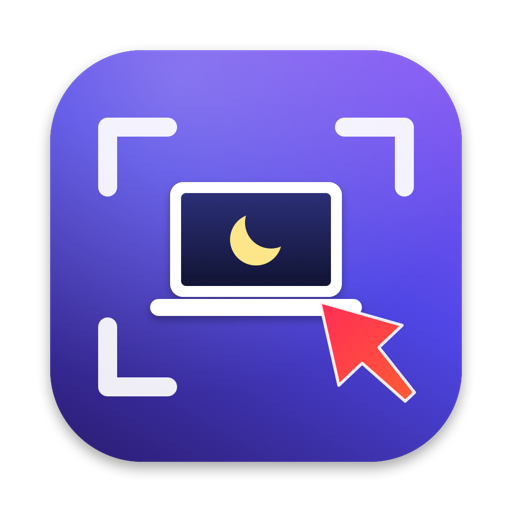

<p align="center"></p>

<h1 align="center">LidShot</h1>

<p align="center">
  A small macOS menu bar app that keeps a MacBook awake with the lid closed and takes screenshots you can annotate.
</p>

The interface is in Russian.

## Install

You need a Mac with Apple Silicon (M1 or newer), macOS 13 Ventura or later, and [Homebrew](https://brew.sh).

```sh
brew install --cask extrik808/tap/lidshot
```

Then open **LidShot** from Applications. A camera icon appears in the menu bar.

Update:

```sh
brew upgrade --cask lidshot
```

Uninstall:

```sh
brew uninstall --cask lidshot
```

If you turned on the password-free toggle (see below), remove it from the app menu before uninstalling.
You can also delete it yourself later with `sudo rm /etc/sudoers.d/lidshot`.

### Why Homebrew removes the quarantine flag

LidShot is not signed with an Apple Developer ID and is not notarized by Apple. A copy downloaded in a browser would
be blocked with "Apple could not verify LidShot". The cask removes the download quarantine flag after installing, so
the app opens normally. If you install from the zip on the
[Releases](https://github.com/Extrik808/LidShot/releases) page instead, run:

```sh
xattr -dr com.apple.quarantine /Applications/LidShot.app
```

## First launch

1. **Screen Recording.** The first screenshot asks for this permission. Turn LidShot on in
   System Settings → Privacy & Security → Screen & System Audio Recording, then quit and reopen LidShot.
   If LidShot is not listed, click **+** and pick `/Applications/LidShot.app`.
2. **Launch at login** is in the menu: «Запускать при входе».

## Closed-lid mode

Menu: «Не спать с закрытой крышкой», or press **⌥⇧L**.

- While it is on, the Mac does not sleep when you close the lid. The menu bar icon turns into a cup.
- «Не спать в течение» turns the mode on for 30 minutes up to 8 hours.
- «Выключать при заряде 10%» turns the mode off when the battery runs low.
- Quitting the app turns the mode off.

Under the hood it runs `pmset -a disablesleep 1`, which needs administrator rights. By default macOS asks for your
password each time. «Включить переключение без пароля…» asks for it once and installs `/etc/sudoers.d/lidshot`.
That file lets your user run only `pmset -a disablesleep 0` and `pmset -a disablesleep 1` without a password.
Timers and the battery auto-off need this, because nobody can type a password while the lid is closed.

If Wi-Fi or a VPN drops with the lid closed, turn off Low Power Mode (System Settings → Battery). The Wi-Fi
antennas sit in the display hinge, so a closed lid also weakens the signal.

## Screenshots

Press **⌥⇧4** and drag over an area. Press Space while selecting to capture a window instead. The editor opens with:

| Tool | Key | Tool | Key |
|---|---|---|---|
| Select & move | V | Highlighter | H |
| Arrow | A | Text | T |
| Line | L | Step number | N |
| Rectangle | R | Pixelate (hide data) | B |
| Ellipse | O | Crop | C |
| Pen | P | | |

- Shift snaps lines to 45° and draws squares and circles.
- Picking a colour or width restyles the selected shape. Double-click text to edit it, and Delete removes a shape.
- **Return** copies the image and closes the editor. **⌘C** copies, **⌘S** saves to a file, and **⌘Z / ⇧⌘Z**
  undo and redo.
- The link button uploads the image to [litterbox.catbox.moe](https://litterbox.catbox.moe) and copies the URL.
  You choose how long the link lives: 1 hour, 12 hours, 24 hours or 3 days. The upload is anonymous but public:
  anyone with the link can open the image until it expires. Pixelate private details first.

## Text from images

LidShot can pull text out of any picture: a screenshot, a photo someone posted in Slack, a scanned document.
Recognition runs on the Mac with Apple's Vision framework. Nothing is uploaded. It reads Russian and English.

- **Hold ⌥⌘** anywhere: the screen freezes for a moment, and you can select text with the mouse right where it
  is, in Slack, a video, a picture or a PDF. Release the keys and the selection is copied. Esc cancels. The keys
  can be changed or the feature turned off in «Выделять текст удержанием».
- **⌥⇧2** («Скопировать текст с экрана»): drag over anything on screen. The text goes straight to the clipboard,
  and a small notice in the corner shows what was copied.
- «Распознать текст из буфера»: copy an image first (for example, right-click a photo in Slack → Copy image),
  then pick this menu item. The text replaces the image in the clipboard.
- «Открыть картинку…» opens an image file in the editor.
- In the editor, the text button (or **X**) lets you select text on the image with the mouse, as in Preview.
  **⌘C** copies the selection, and **Esc** goes back to drawing. The document button (or **⇧⌘C**) copies all the
  text on the image.

All three shortcuts can be changed or turned off in «Горячие клавиши…».

## Build from source

Requires the Xcode Command Line Tools (`xcode-select --install`).

```sh
git clone https://github.com/Extrik808/LidShot.git
cd LidShot
./build.sh            # builds build/LidShot.app
./build.sh --install  # copies it to /Applications and launches it
```

`build.sh` signs the app with a local certificate named «LidShot Local Signing» if your keychain has one
(`Tools/setup-signing.sh` creates it). Otherwise it falls back to an ad-hoc signature. With an ad-hoc signature,
macOS treats every rebuild as a new app and asks for the Screen Recording permission again.

## Releasing a new version (maintainer)

```sh
Tools/release.sh 1.0.1
```

The script:

1. Writes the version into `Info.plist`, commits it, and tags `v1.0.1`.
2. Builds and zips the app.
3. Pushes the commit and tag, then creates a GitHub release with the zip attached.
4. Updates `Casks/lidshot.rb` in [Extrik808/homebrew-tap](https://github.com/Extrik808/homebrew-tap) with the new
   version and SHA-256.

It needs a clean working tree and GitHub credentials. It reads `GH_TOKEN` from the environment, or from the git
credential for github.com.
